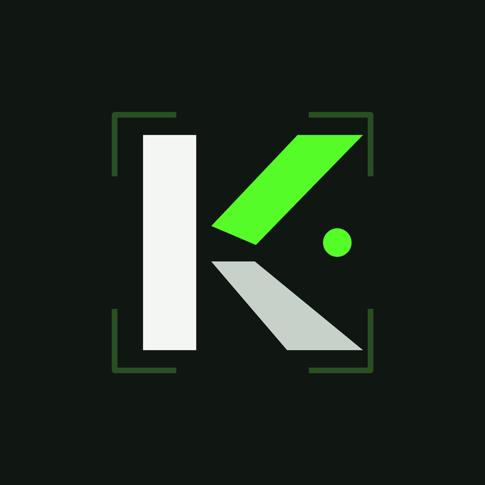
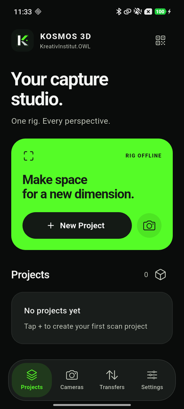
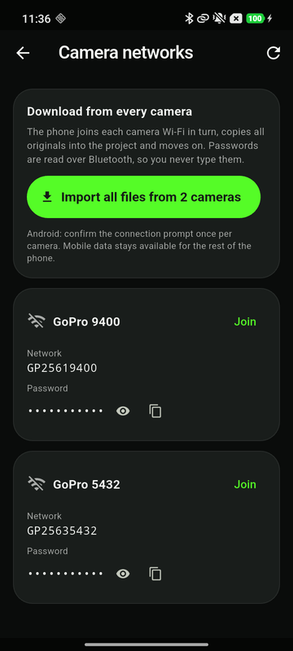
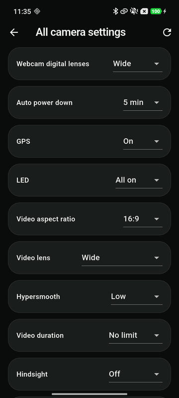

<p align="center">
  
</p>

<h1 align="center">KOSMOS 3D</h1>

<p align="center">
  <strong>Run a whole camera rig from one phone.</strong><br />
  Connect every camera, give them identical settings, trigger them together,<br />
  and bring every original home with its sensor data.
</p>

<p align="center">
  
  
  
  
</p>

<p align="center">
  <a href="#install">Install</a> ·
  <a href="#your-first-scan">First scan</a> ·
  <a href="#getting-the-files-off-the-cameras">Files</a> ·
  <a href="#storage-server">Storage server</a> ·
  <a href="#build-it-yourself">Build</a> ·
  <a href="#license-and-imprint">License</a>
</p>

<p align="center">
  
  
  
</p>

---

## What it is

KOSMOS 3D is a field tool for capturing real places with several cameras at once, for photogrammetry and Gaussian splatting. Mount the cameras and your phone on a rig, and the phone becomes the control desk:

- **Connect** every camera over Bluetooth. No pairing in the phone's system settings.
- **Match** settings across the rig. The app asks each camera what it supports, shows only values that every camera shares, writes them, and reads them back.
- **Capture** on all cameras at the same moment, photo by photo on an interval or as continuous video.
- **Record** the phone's GPS, compass, gyroscope, accelerometer and barometer with every shot. On iPhones with LiDAR it also records measured depth.
- **Collect** the originals from every camera over Wi-Fi, with a checksum for each file.
- **Upload** whole projects to your own storage: any S3-compatible bucket, or the small receiver that runs on your computer.

Today the camera driver speaks [Open GoPro](https://gopro.github.io/OpenGoPro/) (HERO9 and newer, tested with HERO13 Black). Everything above the driver (projects, sync, transfers, sensors, uploads) talks to a generic camera interface, so other Bluetooth cameras and triggers can be added as drivers.

> Not affiliated with GoPro. GoPro, HERO and their logos are trademarks of GoPro, Inc.

## What you need

| | |
| --- | --- |
| Phone | Android 7+ with Bluetooth LE, or iPhone with iOS 14+. A LiDAR iPhone (12 Pro and newer Pro models) adds measured depth. |
| Cameras | GoPro HERO9 Black or newer. Mixed models work; the app limits settings to what all of them share. |
| Optional | GoPro Labs firmware, to set ISO and white balance on every camera with one QR code. A computer for the receiver, or an S3 bucket. |

## Install

### Android

1. Open the latest **[Build workflow run](../../actions/workflows/build.yml)** and download `kosmos3d-android-apk`. Store releases will follow.
2. Open the APK on your phone and allow installing from this source when Android asks.
3. On first launch, allow **Nearby devices** and **Location**. Android needs both to find Bluetooth cameras.

### iPhone

App Store and TestFlight builds are planned. Until then you have two routes:

- **With a Mac:** open `ios/Runner.xcworkspace` in Xcode, choose your team under *Signing & Capabilities*, connect the iPhone and press Run. Details in [ios/BUILD.md](ios/BUILD.md).
- **Without a Mac:** every push builds an unsigned `kosmos3d-ios-unsigned-ipa` in [Actions](../../actions/workflows/build.yml). Install it with [Sideloadly](https://sideloadly.io/) or AltStore using your Apple ID. With a free Apple ID the app expires after 7 days. Free IDs also can't use the *Hotspot Configuration* capability, so join camera Wi-Fi yourself: the app shows each password and a QR code for that.

Allow **Bluetooth**, **Local Network** and **Location** when asked.

## Your first scan

1. **Prepare the cameras.** Switch them on and enable *Wireless Connections* in each camera's menu. Mount them in portrait.
2. **Connect.** Open **Cameras** and tap *Scan*. Tap each camera. It turns green and shows its model and battery.
3. **Match the rig.** Tap the sliders icon for **All camera settings**. Anything marked *Cameras differ* is a problem worth fixing now. Switch *Control mode* to **Pro** on all cameras to unlock the full list.
4. **Set exposure.** Open Protune on each camera, or show all of them the *ISO / white balance* Labs QR (ISO 100 and 5500 K by default). The same QR also syncs each camera clock to the phone.
5. **New project.** Name it and keep **Outdoor Scan** (photo, Linear lens, 1 s interval, target ISO 100) or pick another preset. *Start* checks every camera before the first shot. If one disagrees, you are told which camera and which setting.
6. **Capture.** Walk slowly. The coverage view shows where you have been and which directions are still empty. Tap *Stop* when you are done.

The capture interval is the time **after** all cameras have finished the previous photo, so slow cameras never pile up a queue. In bright daylight with Linear lens the real cadence is close to 1 s.

## Getting the files off the cameras

Bluetooth is too slow for photos, so the originals come over each camera's own Wi-Fi.

**Cameras → Camera networks** reads every camera's Wi-Fi name and password over Bluetooth. Nothing to type. From there:

- **Import all files** joins each camera in turn, copies every original into the project, verifies it with SHA-256, and moves on. Android asks once per camera, iPhone shows a *Join network* prompt.
- **Join** connects to one camera, for browsing or picking single files.
- **Show password / QR** lets a laptop or a second phone join a camera directly.

Where files go:

- Originals are stored **in the app**, per project: `kosmos3d_projects/<project>/captures/<serial>_<folder>_<file>`. Next to each file is a `.receipt.json` with its source path, size and checksum.
- With *Also copy to Photos / Gallery* on, a copy goes to `DCIM/KOSMOS3D` on Android or the Photos app on iPhone.
- The SD cards stay untouched. Delete there when you are sure.
- App storage is removed when the app is uninstalled. Export (**Transfers → Export**) or upload before that.

Downloads run one camera at a time because the phone can only be on one camera network. Downloading from all cameras in parallel over your phone's hotspot is planned for HERO12 and HERO13 (Open GoPro *Camera on Home Network*).

## Storage server

**Settings → Storage server** uploads whole projects to a bucket you own. It works with every S3-compatible service: Backblaze B2, AWS S3, Wasabi, Cloudflare R2, MinIO, or a NAS that speaks S3.

| Field | Example |
| --- | --- |
| Endpoint URL | `https://s3.eu-central-003.backblazeb2.com` |
| Region | `eu-central-003` (left empty, it is read from the endpoint where possible) |
| Bucket | `my-scans` |
| Access key ID / Secret key | from your provider, ideally limited to this one bucket |
| Folder in bucket | `kosmos3d` |

Projects land in `bucket/folder/<project>_<id>/` with the same layout as on the phone: originals, receipts, sensor logs, LiDAR. A file already on the server with the same size is skipped, so an interrupted upload can simply be started again. *Test* tells you exactly what's wrong: unknown key, wrong secret or region, missing bucket, no permission.

Keys are stored in the phone's secure storage (Keychain / Android Keystore), never in project files.

### Prefill for your own test device

For development builds you can bake defaults into the app so the form is already filled in. Copy `config/dev.example.json` to `config/dev.local.json` (ignored by Git), fill it in, and build with:

```bash
flutter run --dart-define-from-file=config/dev.local.json
```

Don't use this for builds you hand to other people: values passed this way are inside the app package.

## Windows receiver

If you would rather keep everything on your own computer, run the receiver from this repository:

```powershell
cd server
.\start_receiver.ps1 -Storage D:\KOSMOS3D_UPLOADS -Port 8787
```

The first start creates a private token in `%LOCALAPPDATA%\KOSMOS3D\receiver-token.txt`. In the app, open **Settings → KOSMOS receiver**, enter `http://<your-computer-ip>:8787` and the token. Phone and computer must be on the same network. Every file is checked with SHA-256 before it is stored. The receiver stores files; it does not reconstruct. More in [server/README.md](server/README.md).

## Sensors and coverage

Every shot writes one line to the project's sensor log: time, GPS position and accuracy, compass heading, phone attitude as a quaternion, barometric pressure, and which cameras acknowledged the shutter. Use it as a prior for alignment in COLMAP, RealityCapture, Metashape or Nerfstudio.

- **LiDAR iPhones** record measured depth frames and show the point cloud live while you scan.
- **Other phones** show the poses in an orbit view (drag to rotate, pinch to zoom, top and front views) coloured by density or height, plus a walking-speed warning. This shows which **directions** you covered, not which surfaces. Overlap is still checked in the photos.

*Capture guidance* in the project settings gives rule-based hints during capture: a heading gap, moving too fast, two shots too similar. It does not analyse the images.

## Honest limits

- **Synchronisation.** The shutter command goes to every camera at the same moment over Bluetooth. That gets cameras within tens of milliseconds, not frame-locked. For moving subjects you need hardware sync.
- **ISO, shutter and white balance** are not in GoPro's official Bluetooth API. Use the Labs QR or set them on each camera once. The app never sends unofficial values.
- **Formatting SD cards** is done on the camera. There is no verified remote command, so the app offers none.
- **Uploads** run while the app is open. Background uploads after the app is closed are on the roadmap.

The full list of what's next is in [docs/ROADMAP.md](docs/ROADMAP.md).

## Build it yourself

You need [Flutter](https://flutter.dev/) (stable channel) and, for iOS, a Mac with Xcode.

```bash
git clone https://github.com/samborghini17/kosmos3d.git
cd kosmos3d
flutter pub get
flutter test
flutter run
```

Before opening a pull request, run all checks:

```bash
flutter analyze
flutter test
python -m unittest discover -s server -p "test_*.py"
```

Project layout:

| Path | What lives there |
| --- | --- |
| `lib/services/gopro_service.dart` | Camera driver: Bluetooth control, settings, Wi-Fi import |
| `lib/services/gopro_protocol.dart` | Open GoPro packet framing and response matching |
| `lib/services/gopro_setting_catalog.dart` | Every Open GoPro setting and value, generated from the official spec |
| `lib/services/capture_coordinator.dart` | Rig state machine: synchronise, start, interval, stop, recover |
| `lib/services/cloud_storage_service.dart` | S3-compatible uploads (SigV4) |
| `lib/l10n/` | English and German text |
| `server/` | Windows / Python receiver |
| `docs/brand/` | Logo options and brand files |

### Adding another camera or Bluetooth device

Implement `CameraServiceInterface` (connect, trigger, stop, apply settings) for the device, plus the `RigCamera` contract used by the capture coordinator (`configure`, `verifyReady`, `start`, `stop`). The coordinator does not know about GoPro. Any device that can confirm "ready" and "started" fits the same synchronised capture flow.

## Privacy

KOSMOS has no account, no analytics and no server of its own. Projects stay on your phone until you export or upload them to a destination you configured. Location is used only to tag your captures.

## License and imprint

Released under the license in [LICENSE](LICENSE).

**KOSMOS 3D** is developed by **Sam Wiemann** for the **Kreativ Institut OWL**.
Imprint and contact: [kreativ.institute](https://kreativ.institute/de)
