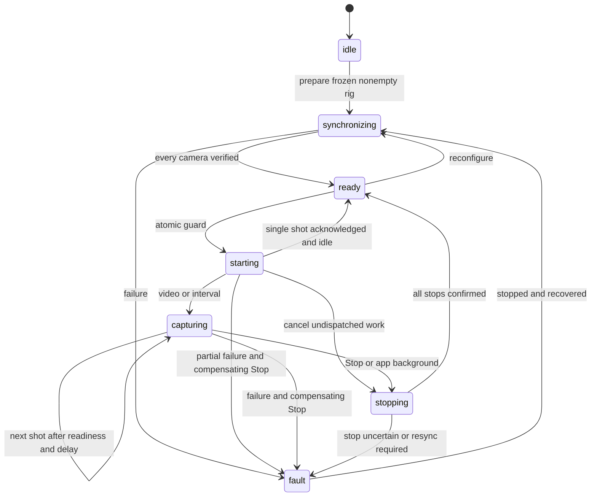

# KOSMOS 3D: implementation and architecture audit

Date: 28 October 2026

Working project: `D:\STORAGE\SAM\KOSMOS3D`

Original: `C:\Users\S024_Calc1\Documents\KOSMOS 3D`

The project was copied before editing: 14,756 files, approximately 4.9 GB, no copy failures. Existing uncommitted work and Git history were preserved. Development took place in the D: copy.

This is a tested control foundation with data-integrity fixes. It is not production certification on HERO10, 11, 12 and 13, and it does not complete every feature in the supplied specification. Remaining work is listed explicitly below.

## Implemented

| Area | Result |
|---|---|
| BLE | Per-connection serialization, packet reassembly, channel/opcode matching, camera ACK handling, bounded timeouts and disconnect failure. |
| Configuration | Runtime preset discovery; Single Photo/Video selection; idle and active-preset verification; capability queries and setting read-back. |
| Register corrections | Video lens 121, photo lens 122 with supported resolution-specific values, photo output 125, bitrate 182. Removed speculative flat-mode and setting-227 writes. |
| Capture | Single-shot and video/interval Start/Stop state machine, no overlapping interval batches, cancellation of undispatched shots, all-camera Stop after a partial failure. |
| Recovery | Unconfirmed Stop retains a recovery action. Reconnect the original camera cohort, retry Stop, then synchronize again. App pause/detach requests Stop. |
| Projects | UI and service creation guards, locked controls during startup, creation only after synchronization, collision-resistant IDs, visible errors and retry. |
| Feedback | Per-camera and per-setting progress. Preset selection is distinct from camera confirmation. |
| Labs | QR recipe for daylight 4K30 video, fixed 5500K, ISO 100–200, 45-degree shutter angle (1/240 s), high bitrate and stabilization/HindSight off. Linear lens is set through BLE. |
| Media | Batch download; identity-prefixed filenames; serial-number-based IP association; partial files, length checks, timeouts, resource cleanup and size-based duplicate skipping. |
| Gallery | Android 10+ MediaStore insertion with pending entries and worker-thread copying. Older Android retains DCIM/MediaScanner behavior. |
| Cloud | B2 hashing and upload now stream originals instead of loading whole videos into memory. Upload remains foreground work. |
| Sensors | Append-only shutter-event JSONL, camera IDs, GPS validity/sample timestamp, phone attitude and quaternion; corrected device-to-ENU convention. |
| Preview | Approximate GPS path with common spatial scale and phone-attitude frustums. Heading coverage is distinguished from object coverage. |
| Exports | Calibrated-frame library for Nerfstudio and COLMAP; validated intrinsics, poses and paths; correct coordinate conversion. Removed fabricated circular poses. |

## State machine

Session membership is immutable. A missing camera is an error; discovery never silently shrinks or enlarges the rig. The guard is set before the first await. A generation counter invalidates future interval work. Stop cancels scheduling immediately, waits for already-dispatched operations, and attempts every original camera. Concurrent Stop calls share a future. A pending Stop also blocks new Start and reconfiguration requests while waiting for the in-flight operation to release its lock. Partial-start cleanup waits for all start results, preventing a late start from following the compensating Stop.

Configuration visits cameras sequentially:

1. Reject unsupported requests and invalidate previous verification.
2. Send shutter Off; wait for System Busy and Encoding Active to clear.
3. Claim external control and validate its protobuf response.
4. Discover available presets and select Single Photo or Video, preferring the active compatible preset.
5. Verify group, preset and flat mode.
6. Query capabilities; apply format/resolution/FPS before dependent settings.
7. Await each setting ACK, wait for idle and read the setting back. Reject mismatches.
8. Recheck mode and all recorded settings before Ready and before each shutter batch.

Keep-alives continue during lengthy synchronization; background polling is suppressed during capture transitions. The keep-alive follows GoPro's reference SDK convention: setting 91, value 66.

Shutters are never retried after an ambiguous timeout. These commands have no transaction ID; a late acknowledgement must not confirm a later command. The link is poisoned until reconnect. Camera processing has a separate 30-second deadline.

References: [state management](https://gopro.github.io/OpenGoPro/docs/ble/protocol/state_management/), [packet protocol](https://gopro.github.io/OpenGoPro/docs/ble/protocol/data_protocol/), [queries](https://gopro.github.io/OpenGoPro/docs/ble/query/), [preset schema](https://github.com/gopro/OpenGoPro/blob/main/protobuf/preset_status.proto), [keep-alive reference](https://github.com/gopro/OpenGoPro/blob/main/demos/python/sdk_wireless_camera_control/open_gopro/gopro_wireless.py).

## Corrections to the supplied assumptions

The published Photo Output enum includes Standard. Its availability must be checked on the actual camera and preset. SuperPhoto/HDR processing can limit cadence. [Setting definitions](https://github.com/gopro/OpenGoPro/blob/main/demos/python/sdk_wireless_camera_control/open_gopro/models/constants/settings.py)

Photo and video shutter options differ. HERO10 photo options include 1/125, 1/250, 1/500, 1/1000 and 1/2000; video choices depend on FPS. A 1/240 video recipe is not universally valid for photos. [HERO10 manual](https://gopro.com/content/dam/help/hero10-black/manuals/HERO10Black_UM_ENG_REVB.pdf)

Concurrent BLE dispatch reduces application-added delay; it cannot guarantee identical exposure times. Radio intervals, firmware scheduling, processing and rolling shutters still cause skew. Exact synchronization requires supported synchronization hardware/protocols and measurement.

Command 0x17 switches the camera access point on/off. It does not provision phone-hotspot credentials. The previous payload was invalid and is now blocked. COHN and network provisioning need separate model/firmware-specific workflows. [Networking](https://gopro.github.io/OpenGoPro/docs/ble/networking/)

## Remaining work and current limits

1. **Numerical ISO, shutter and white-balance BLE overrides are blocked.** Their previous mappings were untrustworthy and are absent from the published setting table used here. `Camera preset` retains camera-configured values, explicitly unverified. Numerical requests fail visibly. Complete override support needs a validated model/firmware adapter and physical test captures. The Labs recipe is an alternative setup route, not verified BLE override support. Existing numerical project presets may need updating.
2. **Intervals are host paced.** The selected duration is a minimum delay after processing; cadence can be slower. Native autonomous intervals and exact exposure scheduling are not implemented.
3. **Automatic hotspot provisioning remains unfinished.** Implement capability negotiation, scanning, connect-new/provisioning notifications, COHN credential/certificate handling and identity verification. Validate each targeted firmware. Mobile OS hotspot/join actions may require user interaction.
4. **No durable OS background uploader.** Add a persistent job ledger, Android WorkManager/foreground transfer service and an iOS background URLSession integration. Resume after termination, reconcile checksums and use B2 multipart large-file upload. Current uploads can stop when the app is suspended or killed.
5. **No calibrated VIO/SLAM or measured surface coverage.** GPS and phone orientation are priors. Gyro samples are logged, but full gyro-aided fusion, bias estimation, timestamp alignment and ARKit/ARCore tracking remain. Each camera needs measured rig extrinsics. Heading sweep percentages cannot establish object coverage.
6. **No complete frame/media reconciliation.** Logs describe acknowledged shutter dispatches, not confirmed exposure timestamps or every decoded video frame. Associate real media IDs, EXIF/GPMF timing and checksummed local files during ingestion. A partially failed batch can still produce files on some cameras.
7. **Calibrated export is a library, not a finished calibration/import UI.** Supply real paths, intrinsics/distortion and camera-to-world poses from reconstruction/VIO. No live COLMAP/Nerfstudio training run was performed.
8. **iOS gallery and device builds remain unvalidated.** A Photos permission/PHPhotoLibrary integration and a macOS iOS build are still needed.
9. **Batch sync is not a project-specific media ledger.** It enumerates available media. Establish a baseline inventory and persistent source IDs before treating a bulk import as exclusively this project's captures. Size-based skipping should eventually be backed by checksums.
10. **Physical acceptance is outstanding.** The protected project-capture path and per-camera tools need real-device tests for long-running transitions, reconnects and model-specific capabilities.

Do not advertise production readiness or parity with Camera Tools for GoPro before these gaps and hardware tests are resolved.

## Media and pose pipeline guidance

Use BLE for control and Wi-Fi for originals. Match HTTP endpoints to serial numbers, never discovery order or editable names. Begin with one bounded stream per camera; benchmark cross-camera concurrency against network throughput and thermal limits. Suspend live preview during transfer. Use turbo mode only where documented and compatible with current state.

Maintain an ingestion ledger keyed by project ID, camera serial, source directory/media ID, size and checksum. Write partial files, validate them and atomically publish. Use resumable Range transfers where supported. Track local download, gallery export and cloud upload separately because they can fail independently. Preserve source-to-local filename mappings.

Use a monotonic clock with a recorded UTC relationship. Preserve sample timestamps, accuracy, calibration state and clock-offset uncertainty. Reconcile commanded triggers with actual EXIF/GPMF exposure times. For video, log continuously and use quaternion SLERP after camera-to-phone clock alignment. Store the calibration version and phone-to-camera transform for each camera.

Use stable exposure and white balance, low noise, sufficient texture and sharp images. Calibrate each lens/resolution/crop/stabilization combination. Linear digital correction does not replace calibration. True surface coverage requires geometry, visibility and image overlap measurements.

The exporter accepts OpenCV camera-to-world poses. Nerfstudio output flips camera Y/Z columns into its OpenGL convention. COLMAP receives the inverse pose: R_wc = R_cw transpose; t_wc = -R_wc times camera center; quaternion order is wxyz. Intrinsics must match actual image dimensions. [Nerfstudio conventions](https://docs.nerf.studio/quickstart/data_conventions.html), [COLMAP format](https://colmap.github.io/format.html)

## Implementation locations

- `lib/services/gopro_protocol.dart`: framing, correlation and timeouts.
- `lib/services/capture_coordinator.dart`: rig/session state machine.
- `lib/services/gopro_service.dart`: camera adapter and verification.
- `lib/screens/project_flow.dart`: atomic startup and progress.
- `lib/screens/capture_session.dart`: Start/Stop, reconnect, logging and lifecycle.
- `lib/services/reconstruction_manifest.dart`: calibrated exporters.
- `lib/widgets/gaussian_labs_qr.dart`: Labs recipe.
- `test/`: protocol, settings, capture, export, duplicate-start and startup tests.

## Local validation

Validation completed on the final source on 28 October 2026:

- Flutter analysis: no issues found.
- Flutter tests: all 26 passed. Coverage includes packet framing and response matching, timeout poisoning, settings read-back failures, sequential configuration, partial-start cleanup, repeated taps, interval cancellation, Stop during preflight, restart/reconfiguration during pending Stop, calibrated export validation, project creation failure/retry and application startup.
- Android debug APK: Gradle `assembleDebug` succeeded. The APK is a development build, not a signed release.
- The build reports future-support warnings for existing Gradle 8.14.0, Android Gradle Plugin 8.11.1 and Kotlin 2.2.20. These did not prevent compilation. Kotlin incremental compilation is disabled because the project and dependency cache are on different Windows drives.
- No physical-camera integration test, Android phone installation test, iOS build or reconstruction training run was performed.

Build output: `build/app/outputs/flutter-apk/app-debug.apk`. Final analysis, test and build logs are saved under the ignored local `work/` directory. The handoff includes a copy of this report, the debug APK and validation logs.

## Hardware acceptance

Test each HERO model/firmware separately, then a mixed rig. Start from Burst, Night Photo, Video, timers enabled, short duration limits and different lenses. Expect a verified common mode or an explicit failure. Exercise physical-button mode changes, full cards, low battery, long RAW/SuperPhoto processing, disconnections at every transition, ACK loss after a shutter, rapid taps and app backgrounding. Measure exposure skew with a visible high-frequency time display. Inspect actual files, mappings, gallery entries and per-camera logs rather than UI counts.

No cameras or phone were used in this audit. Mocks cannot certify radio or firmware behavior.
